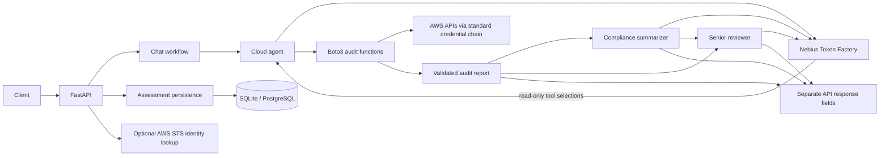

# Indra AI Backend

Indra is a FastAPI backend for read-only AWS security audits and AI-assisted
review. A Cloud agent uses the configured Nebius model to select audit
functions from a fixed allowlist, executes those functions through Boto3, and
returns a typed audit report. Compliance summarizes the report, then Senior
reviews the report and summary. Each agent result is returned in its own API
field.

The backend also provides persisted assessment history, an optional AWS caller
identity check, and environment-configured JWT login. Retrieval/RAG is
temporarily out of scope and will be added separately.

## Current capabilities

- **AWS audit:** Read-only checks for S3, IAM, EC2/EBS, VPC, RDS, CloudTrail,
  and GuardDuty.
- **LLM tool selection:** Cloud interprets the user's request and selects
  applicable audit functions from a fixed allowlist. Tool arguments are
  validated, and regional tools always use `AWS_REGION`.
- **Sequential review:** Cloud audit → Compliance summary → Senior review.
- **Structured output:** The chat API returns the audit report and each
  downstream agent's response separately.
- **Assessment history:** Each completed chat audit is saved as an Assessment,
  including the structured audit report and Senior Reviewer output.
- **Authentication:** Issue short-lived JWTs for one environment-configured
  login account; existing API routes do not yet enforce tokens.
- **AWS identity:** Optional STS caller identity lookup through the standard
  AWS credential chain.
- **Persistence:** SQLite by default, with PostgreSQL-compatible database URLs.
- **Health endpoints:** Process health and basic local readiness status.

This project is a decision-support scaffold, not a cloud control plane. It does
not apply AWS changes, certify compliance, or guarantee security.

## Architecture



### Chat request lifecycle

1. The API validates a bounded user message and optional conversation history.
2. Cloud sends the request to the configured model with the available audit
   functions. The model can select only the exposed functions; it cannot choose
   arbitrary AWS operations, pass resource arguments, or choose other regions.
3. The application executes selected functions through the local Boto3 auditor.
   S3 and IAM checks are global; EC2, VPC, and RDS checks use `AWS_REGION`.
4. The tool results are validated as an `AuditReport`.
5. Compliance creates a short summary grounded in that report.
6. Senior reviews the audit report and Compliance summary.
7. The API returns each result independently. `sources` is currently empty
   because retrieval is not included in this version.

If the user requests a broad audit, Cloud may select all applicable audit
functions. A service-specific request may result in only matching checks.
Findings are point-in-time observations; the absence of a finding is not a
guarantee that a resource is secure.

### Checks included

| Service | Current checks |
| --- | --- |
| S3 | Public access block, public bucket policy/ACL, default encryption, versioning, TLS enforcement, and server access logging |
| IAM | Presence of root-account access keys |
| EC2 / EBS | IPv4/IPv6 world-open security-group ingress, public IPs on running instances, unencrypted volumes, EBS default encryption, and public snapshots |
| VPC | Default VPCs and VPC Flow Logs |
| RDS | Public accessibility, storage encryption, Multi-AZ, instance/cluster backup retention and deletion protection, and public manual instance/cluster snapshots |
| CloudTrail | Multi-region trail coverage, active logging, log-file validation, and log bucket public-access-block/encryption configuration across enabled regions |
| GuardDuty | Detector presence and enabled status in the configured region |

The checks are intentionally read-only. Some permission or service errors are
returned as audit findings; the caller's AWS identity must have the read
permissions needed for the selected checks.

CloudTrail region discovery depends on `ec2:DescribeRegions`; regional trail,
GuardDuty, RDS, and EC2 checks also require their corresponding read
permissions. Findings include a `check_id` and may include check-specific
`evidence`. Missing permissions are represented as audit errors rather than
being treated as a successful check.

## API overview

The API prefix defaults to `/api/v1`. In development, interactive API
documentation is available at `/docs` and `/redoc`.

| Method | Path | Description |
| --- | --- | --- |
| `GET` | `/health` | Process health; does not call AWS or the model |
| `GET` | `/ready` | Basic database readiness configuration |
| `POST` | `/api/v1/auth/login` | Issue a short-lived JWT for the configured environment account |
| `POST` | `/api/v1/chat` | Sequential AWS audit and three-agent review |
| `GET` | `/api/v1/assessments` | List persisted audit assessments |
| `GET` | `/api/v1/assessments/{assessment_id}` | Read audit and reviewer output |
| `GET` | `/api/v1/aws/identity` | Read-only STS caller identity lookup |

Example chat request:

```json
{
  "message": "Check my AWS account for critical security issues.",
  "history": []
}
```

The response includes:

```json
{
  "cloud_agent_response": {
    "audited_regions": ["us-east-1"],
    "audited_services": ["s3", "iam", "ec2", "vpc", "rds"],
    "total_issues": 0,
    "critical_count": 0,
    "high_count": 0,
    "medium_count": 0,
    "low_count": 0,
    "findings": []
  },
  "compliance_agent_response": "Compliance summary...",
  "senior_agent_response": "Senior review...",
  "sources": [],
  "assessment_id": "persisted-assessment-id",
  "status": "completed"
}
```

The report above is an example shape only; actual selected services and
findings depend on the request and the live AWS account. Errors use the API's
structured error response and do not include submitted credentials.

## Requirements and setup

- Python 3.12 or newer
- AWS credentials configured through the Boto3 standard credential chain for
  chat audits and the identity endpoint
- A Nebius Token Factory API key for chat inference

From the repository root:

```bash
python3.12 -m venv .venv
source .venv/bin/activate
python -m pip install --upgrade pip
python -m pip install -e '.[dev]'
cp .env.example .env
```

Set `NVIDIA_API_KEY` in `.env`. The configured default model and endpoint are
`nvidia/Nemotron-3_5-Lightning` and
`https://api.tokenfactory.nebius.com/v1`. The project uses the
OpenAI-compatible Chat Completions format. Do not commit `.env` or share its
contents.

AWS credentials are not accepted in API request bodies. Configure an
appropriately scoped IAM role/profile or other standard Boto3 credential
source, and grant only the read permissions required by the checks. Avoid
using AWS root credentials.

Run locally:

```bash
uvicorn app.main:app --reload
```

The app initializes the configured database schema on startup. Alembic
migrations are available for database-managed deployments:

```bash
alembic upgrade head
```

SQLite is the default. For PostgreSQL, set `DATABASE_URL` and install the
optional driver:

```bash
python -m pip install -e '.[postgres]'
```

## Configuration

All settings can be supplied as environment variables or through `.env`.
Defaults are defined in `app/core/config.py`; `.env.example` is the template.

| Variable | Default | Purpose |
| --- | --- | --- |
| `APP_NAME` | `Indra API` | API service name |
| `APP_ENV` | `development` | Enables `/docs` and `/redoc` in development |
| `DEBUG` | `false` | FastAPI debug setting |
| `API_V1_PREFIX` | `/api/v1` | Versioned API prefix |
| `DATABASE_URL` | `sqlite:///./data/indra.db` | SQLAlchemy database URL |
| `AUTH_USERNAME` | empty | Optional single-account login username |
| `AUTH_PASSWORD` | empty | Optional single-account login password |
| `JWT_SECRET_KEY` | empty | JWT signing key, at least 32 bytes when configured |
| `NVIDIA_BASE_URL` | `https://api.tokenfactory.nebius.com/v1` | OpenAI-compatible Nebius endpoint |
| `NVIDIA_API_KEY` | empty | Nebius credential; required for model calls |
| `NVIDIA_MODEL` | `nvidia/Nemotron-3_5-Lightning` | Inference model |
| `NVIDIA_API_FORMAT` | `openai-chat-completions` | Supported provider adapter |
| `AWS_REGION` | `us-east-1` | Regional AWS audit and identity lookup region |
| `CORS_ORIGINS` | empty | Comma-separated allowed browser origins |
| `MAX_REQUEST_BYTES` | `1048576` | Maximum HTTP request body size |

## Development and validation

Install development dependencies with `python -m pip install -e '.[dev]'`.

```bash
pytest
pytest --cov=app --cov-report=term-missing
ruff check .
ruff format --check .
python -m compileall -q app tests
```

Convenience targets are available:

```bash
make test
make lint
make format
```

The normal test suite uses mocked AWS and provider responses and does not
require live credentials. Live integration checks require configured Nebius
and AWS credentials and can incur provider/AWS usage. Confirm your target
account and permissions before running them.

## Security and limitations

- Login can issue a JWT for a single environment-configured account, but
  existing routes do not yet require or validate it. There is no authorization,
  tenant isolation, or complete audit trail. Assessment IDs are references,
  not access controls.
- The environment-backed login is a bootstrap mechanism, not a full identity
  system; it does not include user management, password reset, rate limiting,
  or account lockout. Deploy behind HTTPS and use secret management.
- AWS requests use the server's standard Boto3 credential chain. Do not run
  with privileged/root credentials.
- Chat only performs the configured allowlisted read-only checks; it does not
  remediate findings or assess every AWS service or control.
- Compliance and Senior outputs are model-generated decision support, not
  formal compliance mappings, legal advice, certification, or a security
  guarantee.
- Retrieval/RAG is not currently included. Chat returns an empty `sources`
  array; a future RAG feature will need to add its own endpoints, ingestion,
  validation, tests, and security controls.

## Project layout

```text
app/
  api/                 FastAPI routes and router registration
  core/                Settings, error handling, logging, middleware
  db/                  SQLAlchemy session and models
  schemas/             Request, response, and audit Pydantic schemas
  services/
    aws/               AWS identity service
    llm/               Cloud, Compliance, Senior agents and workflow
    providers/         Provider adapters
  tools/audit/         Direct Boto3 audit functions
  scripts/               Local environment checks
  tests/                 API, service, audit, and workflow tests
  docs/                  API, architecture, and security notes
```

More detail: [end-to-end project overview](docs/project-overview.md),
[API overview](docs/api.md), [architecture](docs/architecture.md),
[security notes](docs/security.md), and [contribution guide](CONTRIBUTING.md).
