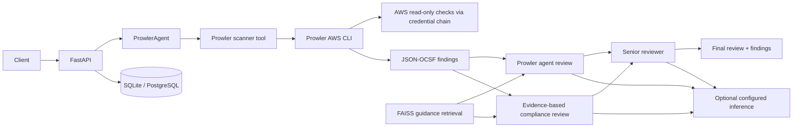

# Indra Backend

Indra is an AI-assisted AWS security assessment backend. It runs the
operator-installed Prowler CLI against the configured AWS credential chain,
reads JSON-OCSF findings, and asks a configured Prowler agent to summarize
them against retrieved guidance. In parallel, a compliance agent assesses the
scan findings against the same guidance. A senior agent reviews both
assessments. It does not generate or execute Terraform and does not provide a
frontend.

> Prowler results are point-in-time decision support. They are not a security
> certification or a guarantee that an AWS account is secure.

## V1 features and limitations

- FastAPI API with safe errors, request IDs, and request-size limits.
- SQLAlchemy project/operation persistence, SQLite by default, and Alembic.
- Optional NVIDIA inference through an explicitly configured OpenAI-compatible
  endpoint, model, key, and API format.
- Prowler CLI scans use the configured AWS credential chain. Requests can set
  the region, service subset, and additional Prowler CLI argument tokens. The
  backend invokes the executable without a shell; requests cannot provide
  shell commands or AWS credentials.
- JSON-OCSF reports are read from a server-created temporary directory and
  returned with agent assessments; reports are not persisted.
- Local FAISS retrieval with trusted local metadata.
- Optional AWS caller identity via the standard AWS credential chain.

This scaffold has no authentication, authorization, tenant isolation, or
complete audit system. It is not a production cloud control plane.

## Architecture



## Scan workflow

`POST /api/v1/prowler/scan` and `POST /api/v1/chat` start a fresh scan. The
request may include `region`, `services`, and `prowler_args`; omitted region
uses `AWS_REGION`, and omitted services use Prowler's default scope. Additional
arguments are passed as individual CLI tokens and cannot override options
managed by the scanner.

The `ProwlerAgent` calls the scanner tool, which invokes the Prowler AWS CLI
with `shell=False`, the standard AWS credential chain, a timeout, and report
size/count limits. It parses the JSON-OCSF output and removes the temporary
report directory after the scan. The workflow retrieves local guidance, then
runs the Prowler review and evidence-based compliance review concurrently
using the findings and retrieved sources. The senior agent reviews both
assessments and returns the final response. API responses include the agent
assessments, operation ID, region, findings, finding count, and source
references. No AWS resources are modified by these routes.

## Technology and prerequisites

Python 3.12+, FastAPI, Uvicorn, Pydantic v2/settings, SQLAlchemy 2.x, Alembic,
FAISS, httpx, Boto3, pytest, pytest-cov, Ruff, and the Prowler CLI.

- Install Prowler separately in an isolated environment (for example, with
  `pipx`) and ensure its executable is on `PATH`, or set `PROWLER_BIN` to its
  executable path. Do not install its dependencies into Indra's Python
  environment.
- Configure AWS credentials using the standard AWS credential chain (for
  example, an AWS profile or workload role). The API does not accept AWS
  access keys in requests.
- Configure NVIDIA inference only if summaries are required. Health, local
  project operations, and RAG can run without NVIDIA or AWS credentials.

## Install and run locally

From the repository root:

```bash
python3.12 -m venv .venv
source .venv/bin/activate
python -m pip install --upgrade pip
python -m pip install -e '.[dev]'
cp .env.example .env
uvicorn app.main:app --reload
```

The API starts without Prowler, NVIDIA, or AWS credentials. Health is
available at `http://127.0.0.1:8000/health`; development docs are at
`http://127.0.0.1:8000/docs`.

For database-managed deployments, run `alembic upgrade head` before starting
the app. SQLite uses `data/indra.db`; PostgreSQL-compatible `DATABASE_URL`
values are supported. Install the optional PostgreSQL driver with
`python -m pip install -e '.[postgres]'`.

## Configuration

Copy `.env.example` to `.env` and set only values you have verified.

| Variable | Default | Purpose |
| --- | --- | --- |
| `APP_NAME` | `Indra API` | Service title |
| `APP_ENV` | `development` | Enables docs only in development |
| `API_V1_PREFIX` | `/api/v1` | Versioned API prefix |
| `DATABASE_URL` | `sqlite:///./data/indra.db` | SQLAlchemy URL |
| `NVIDIA_BASE_URL` | empty | Full provider endpoint; no path is guessed |
| `NVIDIA_API_KEY` | empty | Provider credential; never returned or logged |
| `NVIDIA_MODEL` | empty | Exact model identifier selected by maintainer |
| `NVIDIA_API_FORMAT` | empty | Explicitly opt into a confirmed adapter format |
| `PROWLER_BIN` | `prowler` | Prowler executable name or path |
| `PROWLER_TIMEOUT_SECONDS` | `900` | Maximum scan duration (1–3600 seconds) |
| `AWS_REGION` | `us-east-1` | Region scanned by Prowler and AWS identity lookup |
| `CORS_ORIGINS` | empty | Comma-separated explicit origins |

Only `openai-chat-completions` is implemented for NVIDIA inference. Set
`NVIDIA_API_FORMAT` only after verifying the selected model supports that
request/response format. No provider endpoint or model is inferred.

## RAG ingestion and trust

Put authorized UTF-8 Markdown or text documents in `knowledge_base/`, then run:

```bash
python scripts/ingest_documents.py
python scripts/ingest_documents.py --source-dir /path/to/authorized-docs
```

The ingester downloads nothing. Retrieval metadata preserves supplied
attribution and leaves unknown source details empty. Deploy `index.faiss` and
`metadata.pkl` as a matching pair. Pickle is trusted, locally generated
metadata: never load a user-supplied pickle.

## Security boundaries

- There is no authentication, authorization, tenant isolation, or complete
  audit workflow. Project IDs are not authorization tokens.
- AWS credentials remain in the standard credential chain and are not
  accepted through API requests or written to logs.
- The CLI receives a Prowler AWS command assembled from fixed scanner options
  and optional Prowler argument tokens. It runs without a shell in a restricted
  environment. Its JSON report is limited to 5 MB and 5,000 findings.
- Prompts treat report contents as untrusted data. The agent only summarizes
  findings; it cannot apply remediations or change AWS resources.
- Ensure the AWS identity used by Prowler is appropriate for read-only
  assessment. Scan results and summaries may contain sensitive resource
  identifiers; protect API access and logs accordingly.

## Tests, lint, and formatting

```bash
pytest --cov=app --cov-report=term-missing
ruff check .
ruff format --check .
```

Shortcuts are available with `make test`, `make lint`, and `make format`.
Tests use mocked CLI/provider responses and do not require live cloud
credentials.

See [architecture](docs/architecture.md), [API overview](docs/api.md),
[security notes](docs/security.md), and [CONTRIBUTING.md](CONTRIBUTING.md).
