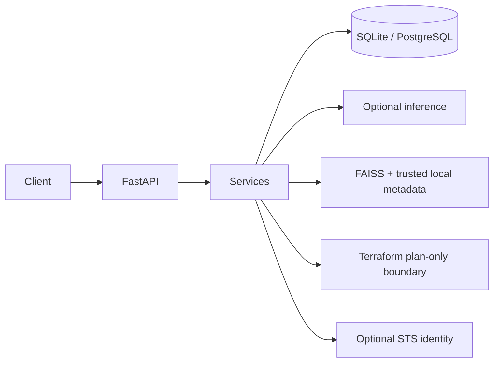
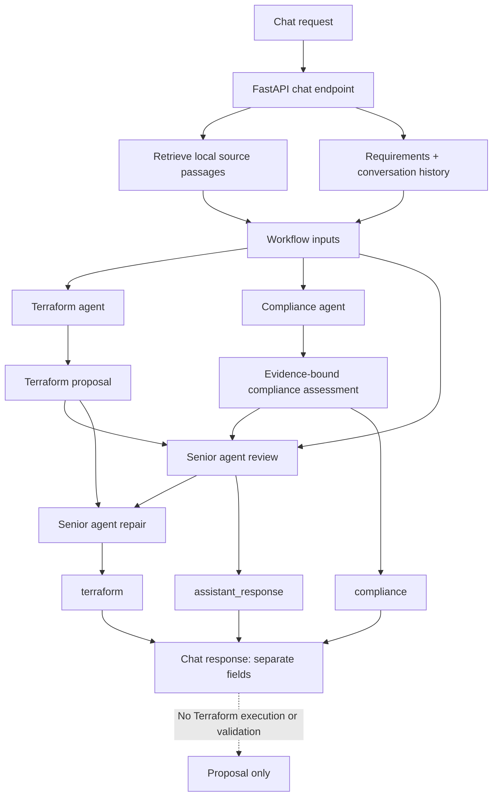

# Indra Backend

Indra is an early-stage, hackathon-oriented AI cloud-infrastructure assistant
backend. It provides project metadata APIs, optional model inference, local
retrieval, and a controlled Terraform plan boundary. It does not provide a
frontend.

> Compliance findings are decision support only. They are not a certification,
> legal advice, or a guarantee that infrastructure is secure.

## V1 features and limitations

- FastAPI API with development docs, request IDs, safe errors, and size limits.
- SQLAlchemy project/operation persistence, SQLite by default, and Alembic.
- Optional NVIDIA inference, enabled only when a verified full endpoint,
  exact model ID, API key, and explicitly supported API format are configured.
- Shared OpenAI-compatible async client base for chat, Terraform, and
  compliance agents; the LLM workflow runs Terraform proposal and compliance
  review concurrently, then asks the senior agent to assess both outputs and
  revise the Terraform proposal. The senior assessment, revised Terraform,
  and compliance assessment are returned as separate fields.
- Editable agent system prompts in `app/services/llm/roles/`; these Markdown
  files are included in package builds and loaded when each agent runs.
- Local 384-dimensional feature-hash retrieval with FAISS and attributed,
  trusted metadata. The baseline is lexical, not semantic.
- Optional AWS caller identity using the standard credential chain; credentials
  are not accepted through chat or persisted.
- Terraform proposal, caller-diagnostic repair, formatting, validation, and
  plan-only boundaries. Repair uses the senior Nemotron agent and does not run
  Terraform commands.

This scaffold has no authentication, authorization, tenant isolation, complete
audit system, or frontend. Apply and destroy are disabled. Do not use it as a
production deployment control plane.

## Architecture



See [architecture](docs/architecture.md), [API overview](docs/api.md), and
[security notes](docs/security.md).

## Agent workflow

For each chat request, the API retrieves any matching local source passages and
passes the requirements, retrieved evidence, and conversation history into the
LLM workflow:



Terraform generation and compliance review run concurrently; the diagram
shows both branches feeding the subsequent senior review.

1. **Terraform and compliance run concurrently.** The Terraform agent generates
   an infrastructure proposal from the requirements. At the same time, the
   compliance agent reviews the requirements against only the retrieved source
   passages; with no passages, its result should report insufficient evidence.
2. **Senior review assesses both results.** After both agents finish, the senior
   agent receives the requirements, Terraform proposal, compliance assessment,
   source metadata, and conversation history. It returns a user-facing
   assessment without merging the Terraform or compliance content into that
   assessment.
3. **Senior repair revises the proposal.** The senior agent receives the
   original Terraform and its own review as repair diagnostics and returns the
   revised Terraform proposal. The compliance result remains the original
   evidence-bound assessment.
4. **The API returns three separate values:** `assistant_response` (senior
   assessment), `terraform` (revised proposal), and `compliance` (compliance
   assessment). The workflow does not run Terraform commands, validate the
   generated HCL, apply infrastructure, or certify compliance.

Terraform and compliance use the configured `NVIDIA_MODEL`. Senior review and
repair currently override it with `nvidia/nemotron-3-super-120b-a12b`. The
agents' system prompts are maintained in
[`app/services/llm/roles/`](app/services/llm/roles/); the senior role file has
separate review and repair prompt sections.

## Technology

Python 3.12+, FastAPI, Uvicorn, Pydantic v2/settings, SQLAlchemy 2.x, Alembic,
FAISS, httpx, Boto3, pytest, pytest-cov, Ruff, and Terraform CLI.

## Prerequisites

- Python 3.12 or newer.
- Terraform CLI only if you want to use validation or plan endpoints.
- NVIDIA credentials only after confirming a specific Token Factory model,
  full endpoint, and request format.
- AWS credentials are optional and use the standard AWS credential chain.

## Install and run locally

From the repository root:

```bash
python3.12 -m venv .venv
source .venv/bin/activate
python -m pip install --upgrade pip
python -m pip install -e '.[dev]'
cp .env.example .env
uvicorn app.main:app --reload
```

The API starts without NVIDIA or AWS credentials. Health is available at
`http://127.0.0.1:8000/health`; development docs are at
`http://127.0.0.1:8000/docs`.

Agent behavior prompts are maintained in
[`app/services/llm/roles/`](app/services/llm/roles/): `terraform_role.md`,
`compliance_role.md`, and `senior_role.md`. The senior role has separate review
and repair sections. Prompt edits are read on the next agent request without
changing Python code; the chat workflow returns its senior assessment in
`assistant_response`, proposed Terraform in `terraform`, and evidence-bound
compliance results in `compliance`.

For schema-managed deployments, run `alembic upgrade head` before starting the
app. A fresh local development launch creates its SQLite schema automatically.
SQLite uses `data/indra.db`; a PostgreSQL-compatible `DATABASE_URL` can be
configured for other environments. Install the PostgreSQL driver with
`python -m pip install -e '.[postgres]'` and use a SQLAlchemy URL such as
`postgresql+psycopg://...`.

A live smoke test using a maintainer-provided Token Factory endpoint and model
returned all three workflow fields, but the generated HCL had a
`required_providers` block outside the required `terraform` block and the
senior review missed that syntax issue. Treat live model output as unverified:
the chat workflow does not run Terraform validation, plan, or deployment. Use
a controlled workspace to check generated HCL before relying on it. The smoke
test used no source passages, so its compliance result correctly reported
insufficient evidence; it was not a compliance certification.

## Configuration

Copy `.env.example` to `.env` and set only values you have verified. Important
settings:

| Variable | Default | Purpose |
| --- | --- | --- |
| `APP_NAME` | `Indra API` | Service title |
| `APP_ENV` | `development` | Enables docs only in development |
| `API_V1_PREFIX` | `/api/v1` | Versioned API prefix |
| `DATABASE_URL` | `sqlite:///./data/indra.db` | SQLAlchemy URL |
| `NVIDIA_BASE_URL` | empty | Full provider endpoint; no path is guessed |
| `NVIDIA_API_KEY` | empty | Provider credential; never returned or logged |
| `NVIDIA_MODEL` | empty | Exact model identifier selected by maintainer |
| `NVIDIA_API_FORMAT` | empty | Explicitly opt into a confirmed adapter format |
| `EMBEDDING_MODEL` | `local-feature-hash-v1` | Local lexical baseline identifier |
| `FAISS_INDEX_PATH` | `./faiss_store/index.faiss` | FAISS index file |
| `FAISS_METADATA_PATH` | `./faiss_store/metadata.pkl` | Trusted local metadata |
| `TERRAFORM_BIN` | `terraform` | Executable name/path set by operator |
| `TERRAFORM_WORKSPACE_ROOT` | `./data/terraform_workspaces` | Controlled operation workspaces |
| `AWS_REGION` | `us-east-1` | AWS identity lookup region |
| `CORS_ORIGINS` | empty | Comma-separated explicit origins |

`openai-chat-completions` is the only currently implemented NVIDIA API format.
Set `NVIDIA_API_FORMAT=openai-chat-completions` only after verifying that the
selected Token Factory model supports the compatible request and response
format. `NVIDIA_BASE_URL` must be the full endpoint. No NVIDIA model ID or
endpoint is bundled or inferred.

## RAG ingestion and trust

Put authorized UTF-8 Markdown or text documents in `knowledge_base/`, then run:

```bash
python scripts/ingest_documents.py
python scripts/ingest_documents.py --source-dir /path/to/authorized-docs
```

The ingester downloads nothing. Retrieval metadata includes local source
titles and leaves source URLs, dates, versions, and section IDs empty if the
input does not provide them. Rebuild and deploy `index.faiss` and
`metadata.pkl` as a matching pair. The pickle is trusted, locally generated
metadata: `pickle.load` is unsafe for untrusted files. Never upload or load a
user-supplied pickle. The default feature-hash vectors are a local lexical
baseline, not semantic model embeddings.

## Terraform safety

Terraform operates only through a fixed command allowlist, argument arrays,
`shell=False`, server-generated per-operation workspaces, execution timeouts,
and output limits. Generated code is a proposal, never an execution command.
The V1 HCL policy permits AWS resources/provider only and rejects modules,
provider endpoint overrides, inline credentials, provisioners, and backend
blocks. V1 allows format check, backend-disabled init, validate, and plan. It does not
run `apply` or `destroy`; both endpoints return 501. Do not treat these
controls as production isolation or authorization.

Terraform state and plan files can contain secrets. Do not commit state,
plans, `.terraform/`, credentials, or generated workspaces. Review HCL and
plan output through your normal secure process before any deployment.

## Tests, lint, and formatting

```bash
pytest --cov=app --cov-report=term-missing
ruff check .
ruff format --check .
```

Shortcuts are available with `make test`, `make lint`, and `make format`.
CI runs on Python 3.12 and requires no live provider or cloud credentials.

## Governance

See [CONTRIBUTING.md](CONTRIBUTING.md), [CODE_OF_CONDUCT.md](CODE_OF_CONDUCT.md),
[SECURITY.md](SECURITY.md), [SUPPORT.md](SUPPORT.md), and [CHANGELOG.md](CHANGELOG.md).
The [MIT license](LICENSE) contains copyright-holder and year placeholders for
the maintainer to replace before publishing.
