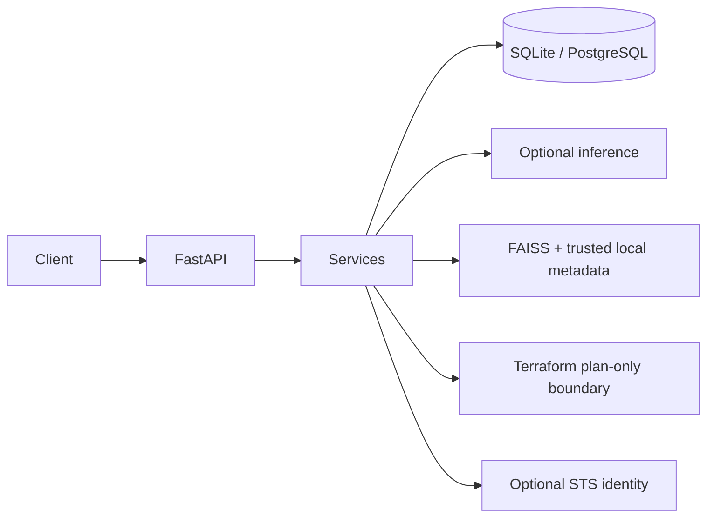

# Indra Backend

Indra is an early-stage, hackathon-oriented AI cloud-infrastructure assistant
backend. It provides project metadata APIs, optional model inference, local
retrieval, and a controlled Terraform plan boundary. It does not provide a
frontend.

> Compliance findings are decision support only. They are not a certification,
> legal advice, or a guarantee that infrastructure is secure.

## V1 features and limitations

- FastAPI API with development docs, request IDs, safe errors, and size limits.
- SQLAlchemy project/operation persistence, SQLite by default, and Alembic.
- Optional NVIDIA inference, enabled only when a verified full endpoint,
  exact model ID, API key, and explicitly supported API format are configured.
- Local 384-dimensional feature-hash retrieval with FAISS and attributed,
  trusted metadata. The baseline is lexical, not semantic.
- Optional AWS caller identity using the standard credential chain; credentials
  are not accepted through chat or persisted.
- Terraform proposal, formatting, validation, and plan-only boundaries.

This scaffold has no authentication, authorization, tenant isolation, complete
audit system, or frontend. Apply and destroy are disabled. Do not use it as a
production deployment control plane.

## Architecture



See [architecture](docs/architecture.md), [API overview](docs/api.md), and
[security notes](docs/security.md).

## Technology

Python 3.12+, FastAPI, Uvicorn, Pydantic v2/settings, SQLAlchemy 2.x, Alembic,
FAISS, httpx, Boto3, pytest, pytest-cov, Ruff, and Terraform CLI.

## Prerequisites

- Python 3.12 or newer.
- Terraform CLI only if you want to use validation or plan endpoints.
- NVIDIA credentials only after confirming a specific Token Factory model,
  full endpoint, and request format.
- AWS credentials are optional and use the standard AWS credential chain.

## Install and run locally

From the repository root:

```bash
python3.12 -m venv .venv
source .venv/bin/activate
python -m pip install --upgrade pip
python -m pip install -e '.[dev]'
cp .env.example .env
uvicorn app.main:app --reload
```

The API starts without NVIDIA or AWS credentials. Health is available at
`http://127.0.0.1:8000/health`; development docs are at
`http://127.0.0.1:8000/docs`.

For schema-managed deployments, run `alembic upgrade head` before starting the
app. A fresh local development launch creates its SQLite schema automatically.
SQLite uses `data/indra.db`; a PostgreSQL-compatible `DATABASE_URL` can be
configured for other environments.

## Configuration

Copy `.env.example` to `.env` and set only values you have verified. Important
settings:

| Variable | Default | Purpose |
| --- | --- | --- |
| `APP_NAME` | `Indra API` | Service title |
| `APP_ENV` | `development` | Enables docs only in development |
| `API_V1_PREFIX` | `/api/v1` | Versioned API prefix |
| `DATABASE_URL` | `sqlite:///./data/indra.db` | SQLAlchemy URL |
| `NVIDIA_BASE_URL` | empty | Full provider endpoint; no path is guessed |
| `NVIDIA_API_KEY` | empty | Provider credential; never returned or logged |
| `NVIDIA_MODEL` | empty | Exact model identifier selected by maintainer |
| `NVIDIA_API_FORMAT` | empty | Explicitly opt into a confirmed adapter format |
| `EMBEDDING_MODEL` | `local-feature-hash-v1` | Local lexical baseline identifier |
| `FAISS_INDEX_PATH` | `./faiss_store/index.faiss` | FAISS index file |
| `FAISS_METADATA_PATH` | `./faiss_store/metadata.pkl` | Trusted local metadata |
| `TERRAFORM_BIN` | `terraform` | Executable name/path set by operator |
| `TERRAFORM_WORKSPACE_ROOT` | `./data/terraform_workspaces` | Controlled operation workspaces |
| `AWS_REGION` | `us-east-1` | AWS identity lookup region |
| `CORS_ORIGINS` | empty | Comma-separated explicit origins |

`openai-chat-completions` is the only currently implemented NVIDIA API format.
Set `NVIDIA_API_FORMAT=openai-chat-completions` only after verifying that the
selected Token Factory model supports the compatible request and response
format. `NVIDIA_BASE_URL` must be the full endpoint. No NVIDIA model ID or
endpoint is bundled or inferred.

## RAG ingestion and trust

Put authorized UTF-8 Markdown or text documents in `knowledge_base/`, then run:

```bash
python scripts/ingest_documents.py
python scripts/ingest_documents.py --source-dir /path/to/authorized-docs
```

The ingester downloads nothing. Retrieval metadata includes local source
titles and leaves source URLs, dates, versions, and section IDs empty if the
input does not provide them. Rebuild and deploy `index.faiss` and
`metadata.pkl` as a matching pair. The pickle is trusted, locally generated
metadata: `pickle.load` is unsafe for untrusted files. Never upload or load a
user-supplied pickle. The default feature-hash vectors are a local lexical
baseline, not semantic model embeddings.

## Terraform safety

Terraform operates only through a fixed command allowlist, argument arrays,
`shell=False`, server-generated per-operation workspaces, execution timeouts,
and output limits. Generated code is a proposal, never an execution command.
V1 allows format check, backend-disabled init, validate, and plan. It does not
run `apply` or `destroy`; both endpoints return 501. Do not treat these
controls as production isolation or authorization.

Terraform state and plan files can contain secrets. Do not commit state,
plans, `.terraform/`, credentials, or generated workspaces. Review HCL and
plan output through your normal secure process before any deployment.

## Tests, lint, and formatting

```bash
pytest --cov=app --cov-report=term-missing
ruff check .
ruff format --check .
```

Shortcuts are available with `make test`, `make lint`, and `make format`.
CI runs on Python 3.12 and requires no live provider or cloud credentials.

## Governance

See [CONTRIBUTING.md](CONTRIBUTING.md), [CODE_OF_CONDUCT.md](CODE_OF_CONDUCT.md),
[SECURITY.md](SECURITY.md), [SUPPORT.md](SUPPORT.md), and [CHANGELOG.md](CHANGELOG.md).
The [MIT license](LICENSE) contains copyright-holder and year placeholders for
the maintainer to replace before publishing.
