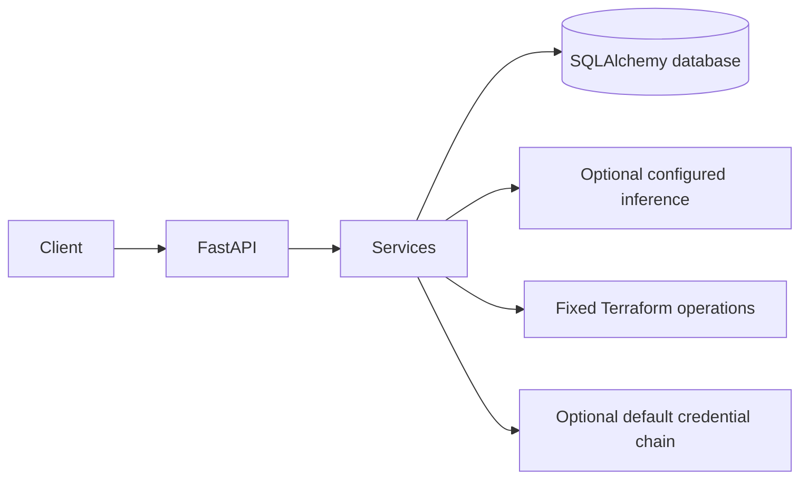

# Archived architecture draft

This document describes an earlier, incompatible Terraform workflow and is
preserved only as historical reference. It does not describe the current
application or its React frontend; see [../architecture.md](../architecture.md),
[../HOW_TO.md](../../HOW_TO.md), and [../api.md](../../api.md) for current behavior.

The application is a single FastAPI process. HTTP routes perform validation
and dependency injection, while services own provider and execution
boundaries. SQLAlchemy supports SQLite for local development and compatible
PostgreSQL URLs. Alembic is the schema migration mechanism.

The LLM workflow receives senior, Terraform, and compliance agents as
dependencies. It runs Terraform proposal generation and evidence-bound
compliance review concurrently. It passes both results to the senior agent for
a final assessment, then asks the senior agent to revise the Terraform proposal
using that assessment. The senior assessment, revised Terraform source, and
original compliance assessment remain separate workflow results; the review
does not merge either artifact into its response. The chat workflow does not
execute Terraform or validate the generated configuration.

Terraform and compliance use the configured `NVIDIA_MODEL`. Senior review and
repair currently use the model override `nvidia/nemotron-3-super-120b-a12b`,
independent of that setting. Each agent's system prompt is loaded from the
packaged Markdown files in `app/services/llm/roles/`; the senior file separates
review and repair instructions.

A live provider smoke test confirmed that this multi-step workflow can return
all three fields. That run also produced HCL with a `required_providers` block
outside the required `terraform` block, which the senior assessment failed to
catch. A successful model response is therefore not evidence of syntactic
validity, a successful Terraform validation, compliance, or deployability.
Run Terraform checks in a controlled workspace before relying on generated HCL.

NVIDIA inference uses the configured Nebius Token
Factory endpoint and `nvidia/Nemotron-3_5-Lightning` model by default. A valid
`NVIDIA_API_KEY` is still required to enable inference.

There is no authentication or authorization implementation in this
scaffold. Assessment identifiers are references, not access controls.
