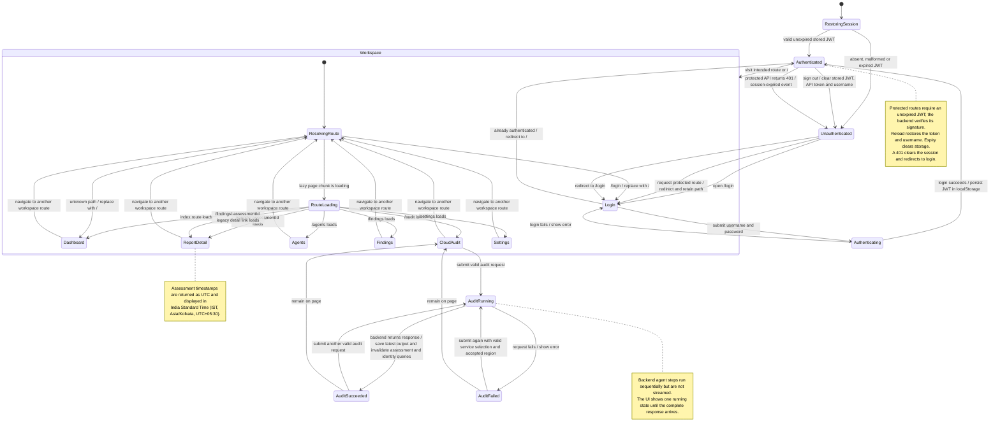

# Frontend state machine

This diagram describes the React frontend's current session, route, and audit
behavior. The JWT is stored in localStorage and restored on reload until its expiry.
Sign-out, expiry, or a protected API 401 removes the stored token.

## State and transition notes

- The login route is public. Protected routes redirect unauthenticated visitors
  to `/login` and retain the requested location for post-login navigation.
- The application displays a shared loading state while a lazy route chunk is
  loading. Unknown paths redirect to the dashboard.
- On audit submission, the frontend requires at least one selected service and
  confirmation of the backend-configured AWS region before sending a request.
- Successful audit output is put in the `latest-audit` query cache. It is not
  persisted across a browser reload; the `latest-audit` query itself is disabled
  until the current session supplies data.
- Assessment and AWS identity query data refresh after a successful audit.
  Query-backed pages can independently display loading, error, empty, and
  loaded states.
- API failures remain on the current page with an error message, except for
  `401` responses, which expire the session and redirect to login.
