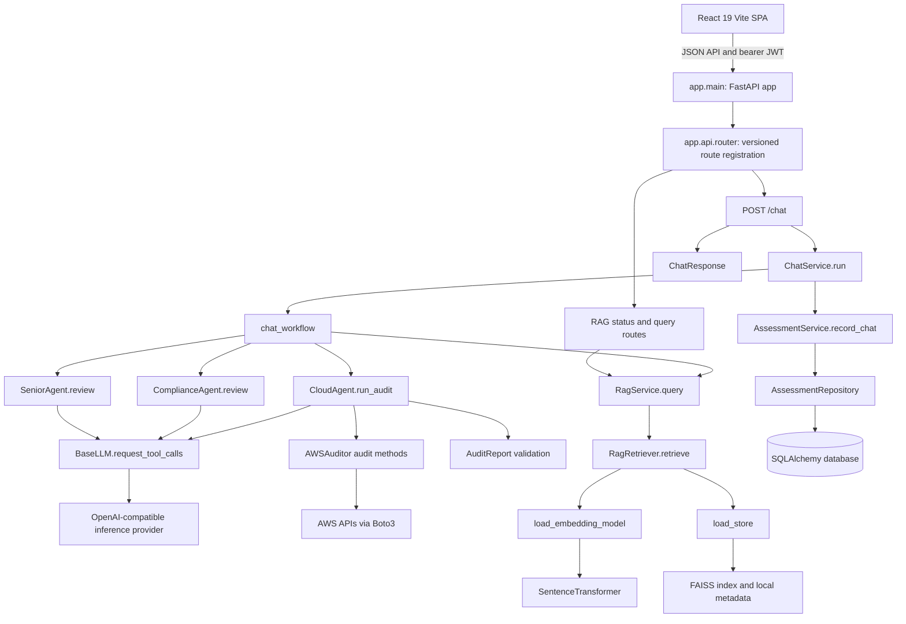
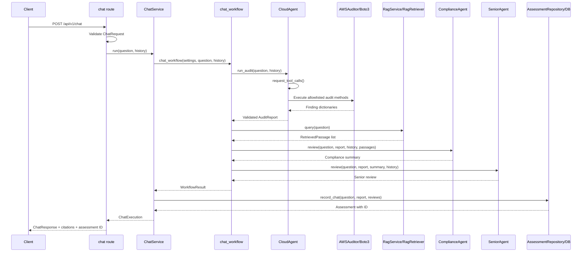
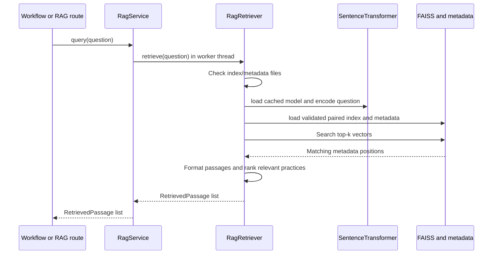

# Low-Level Design

## 1. Purpose and scope

This document describes how the Indra-AI backend's modules and functions
collaborate at runtime. It focuses on the FastAPI request boundary, the AWS
audit and review workflow, local FAISS retrieval, persistence, and supporting
API services.

The backend performs read-only AWS checks. It does not apply remediations or
certify compliance. Chat assessment history stores the question, audit report,
Compliance review, and Senior review; RAG citations are returned in the chat
response but are not persisted with the assessment.

The JavaScript-only React frontend is a separate HTTP API client. It does not
import backend modules or connect to AWS/FAISS directly. Its API client
handles authenticated requests and its presentation layer keeps Cloud,
Compliance, Senior, and source data separate. A shared React Markdown view
formats Compliance and Senior response strings; the Cloud report remains
structured JSON.

## 2. Component map

### Package responsibilities

| Package | Responsibility |
| --- | --- |
| `app/main.py` | Create the FastAPI application, register middleware and exception handlers, include routers, and initialize the database on startup. |
| `app/api/` | HTTP endpoints; parse validated request schemas, get settings/database sessions through dependencies, invoke services, and shape response schemas. |
| `app/schemas/` | Pydantic contracts for incoming requests and outgoing API payloads, plus the typed AWS audit report. |
| `app/services/` | Use-case orchestration and boundaries to retrieval, inference, AWS identity, and persistence. |
| `app/services/llm/` | Shared provider adapter and the Cloud, Compliance, and Senior agents. |
| `app/services/rag/` | Local embedding model, FAISS store loading, ranked retrieval, passage formatting, and the RAG application service. |
| `app/tools/audit/` | Read-only AWS audit implementations, grouped by AWS service and composed by `AWSAuditor`. |
| `app/repositories/` | Database queries and writes for persisted assessments. |
| `app/db/` | SQLAlchemy models, engine/session lifecycle, and migration-backed schema initialization. |
| `app/core/` | Environment configuration, common errors and handlers, logging, middleware, and login/JWT helpers. |

### Browser response path

1. The frontend API service attaches the bearer token and sends a chat request
   to `POST /api/v1/chat`.
2. The browser waits for the full non-streaming response; it does not invent
   per-agent progress or outputs.
3. The workflow response is stored and presented as separate Cloud,
   Compliance, Senior, and source sections.
4. Compliance and Senior strings are passed to the shared Markdown component
   using React Markdown and the GFM plugin. Raw HTML is not enabled.
5. Cloud findings remain structured JSON for counts, evidence, and resource
   details; they are not parsed as agent-response Markdown.

## 3. Application startup and shared dependencies

1. Importing `app.main` calls the cached `get_settings()` function and
   configures logging.
2. The FastAPI lifespan invokes `initialize_database(settings)`, which applies
   Alembic migrations before serving requests.
3. `RequestContextMiddleware` enforces the configured request-body size and
   adds request context. CORS middleware is added only when origins are
   configured.
4. `register_error_handlers(app)` maps `AppError` and request validation
   failures to stable JSON error responses. Unexpected exceptions are returned
   as a generic 500 response.
5. `app.api.router` registers auth, assessment, chat, RAG, and AWS routes under
   the configured API prefix. The login router is public; the other versioned
   routers receive the shared `require_access_token` dependency. The health
   router is mounted separately.
6. Route dependencies call `get_settings()` for cached runtime configuration.
   Database-backed routes use `get_db()` to yield a SQLAlchemy `Session`;
   `get_db()` closes the session after the request.

`app/api/dependencies.py` defines `require_access_token()`. It uses FastAPI's
HTTP Bearer parser to extract the authorization credential, raises the
standard `authentication_required` error when no bearer token is supplied,
and delegates signature, algorithm, and expiration checks to
`verify_access_token()`. The public auth router is registered without this
dependency so `POST /api/v1/auth/login` can issue a token. Assessment, chat,
RAG, and AWS routers are registered with it. Root, health, readiness, and
development documentation routes are outside the protected versioned router.

`Settings` owns provider configuration, AWS region, database URL, FAISS paths,
embedding model, authentication values, CORS origins, and request-size limits.
Relative FAISS paths are resolved against `PROJECT_ROOT` by
`resolve_store_path()`.

## 4. Chat and assessment workflow

### 4.1 Request path

`POST /api/v1/chat` is implemented in `app/api/routes/chat.py`:

1. FastAPI validates the JSON body using `ChatRequest`. `message` is required;
   each history item is limited to the `user` or `assistant` role.
2. The route converts history models to dictionaries and calls
   `ChatService(settings, session).run(message, history)`.
3. `ChatService.run()` calls `chat_workflow()` with the request and settings.
4. When the workflow succeeds, `ChatService.run()` passes its audit report and
   agent outputs to `AssessmentService.record_chat()`.
5. The route maps the `ChatExecution` result to `ChatResponse`. Sources are
   included in this response but are not passed to assessment persistence.

### 4.2 `chat_workflow()` order

The function in `app/services/llm/workflow.py` performs these stages in order:

1. Construct `RagService` from settings.
2. Create `CloudAgent`, `ComplianceAgent`, and `SeniorAgent` in async context
   managers. The agents share the `BaseLLM` provider lifecycle, and each
   initialized client is closed when the context exits.
3. Call `ComplianceAgent.ensure_configured()` before beginning AWS work. This
   validates inference settings without creating a provider client.
4. Call `CloudAgent.run_audit(question, history)` to select and execute audit
   checks. It returns an `AuditReport`.
5. Call `RagService.query(question)` to retrieve local guidance passages.
6. Call `ComplianceAgent.review(...)` with the question, audit report, history,
   and retrieved passages. It returns a text summary.
7. Call `SeniorAgent.review(...)` with the same question and audit report,
   plus the Compliance summary and history. It returns a text review.
8. Return a `WorkflowResult` containing the serialized audit report, both
   reviews, and source citations derived from the retrieved passages.

The workflow is sequential: neither Compliance nor Senior starts before the
preceding inputs are available. RAG retrieval runs after the AWS audit and
before Compliance; Senior receives the report and Compliance summary, not the
passage list.

### 4.3 Cloud audit selection and execution

`CloudAgent.run_audit()` coordinates inference and local audit code:

1. It calls `BaseLLM.request_tool_calls()` with the user's request, the
   generated `AUDIT_REPORT_JSON_SCHEMA`, the allowed `AUDIT_TOOLS`, optional
   history, and the Cloud role prompt.
2. The provider may select from the fixed functions `audit_s3`, `audit_iam`,
   `audit_ec2`, `audit_vpc`, `audit_databases`, `audit_cloudtrail`, and
   `audit_guardduty`. Each tool has no input parameters.
3. The returned function names are resolved through a local map to concrete
   methods on `AWSAuditor`. Duplicate/unknown tools, invalid JSON arguments,
   or non-empty arguments are rejected. This keeps the model from passing
   arbitrary AWS resources, operations, or regions.
4. Each selected audit method runs in `asyncio.to_thread()` so synchronous
   Boto3 work does not block the event loop. Regional methods receive
   `settings.aws_region`; global methods do not receive a region argument.
5. The agent aggregates selected services, regions, severity counts, and
   findings, then calls `AuditReport.model_validate()` before returning.
   Provider, AWS, and schema failures are translated to `AppError`.

`AWSAuditor` in `app/tools/audit/aws_audit.py` combines service-specific audit
mixins. The mixins make Boto3 calls and return finding dictionaries. Shared
helpers in `app/tools/audit/aws/common.py` create finding/error shapes and
collect paginated API results. The Cloud agent, rather than `AWSAuditor.run_audit`,
is the selection/execution path used by the chat workflow.

### 4.4 Compliance and Senior review

- `ComplianceAgent.review()` converts each `RetrievedPassage` with
  `as_prompt_data()`, serializes the validated report, and builds a prompt that
  distinguishes AWS account findings from general retrieved guidance. It
  includes document titles for attribution and then calls `BaseLLM.complete()`
  using the Compliance role prompt.
- `SeniorAgent.review()` serializes the same validated report and includes the
  Compliance response. It asks the provider to check the summary against
  structured evidence, flag unsupported claims, and state uncertainty. It
  calls `BaseLLM.complete()` using the Senior role prompt.
- Both agents inherit provider configuration, history validation, response
  validation, and error mapping from `BaseLLM`.

`load_role_prompt()` reads the role Markdown files from
`app/services/llm/roles/`; role-specific prompt content is separate from the
agent logic.

### 4.5 Assessment persistence

After all workflow stages complete:

1. `AssessmentService.record_chat()` delegates to
   `AssessmentRepository.create_from_chat()`.
2. The repository creates an `Assessment` ORM object with the question, JSON
   audit report, Compliance output, Senior output, and completed status.
3. The repository adds and commits the object, refreshes it, and returns it.
4. `ChatService` copies its generated ID into `ChatExecution`.

Assessment read routes call `AssessmentService.list()` or `.get()`, which in
turn call repository queries. `.get()` raises `assessment_not_found` when no
record exists.

## 5. RAG module and function interactions

### 5.1 RAG module responsibilities

| Module | Key functions/types | Role in the call path |
| --- | --- | --- |
| `app/services/rag/service.py` | `RagService.__init__`, `.query`, `.status` | Resolves configured artifact paths, creates a retriever, exposes asynchronous retrieval, and reports artifact presence. |
| `app/services/rag/retrieval.py` | `RagRetriever.__init__`, `.retrieve`, `_format_passage`, `_relevant_practices`, `_string`, `_strings`, `_tokens` | Performs vector search and transforms matching metadata into attributed, bounded guidance passages. |
| `app/services/rag/embedding.py` | `load_embedding_model()` | Lazily loads and caches the configured CPU SentenceTransformer. |
| `app/services/rag/store.py` | `resolve_store_path`, `is_string_dict`, `is_document_list`, `load_store` | Resolves paths and loads/validates the FAISS index and its trusted, paired pickle metadata. |
| `app/services/rag/models.py` | `RetrievedPassage`, `RagStatus` | Typed values exchanged between retrieval, agents, service, and API routes. |
| `app/schemas/rag.py` | `RagQueryRequest`, `RagQueryResponse`, `RagPassage`, `RagStatusResponse` | HTTP request and response validation/serialization. |
| `app/api/routes/rag.py` | `rag_status`, `rag_query` | Exposes direct RAG status and query operations over HTTP. |

### 5.2 Query path and retrieval steps

Both `chat_workflow()` and the RAG HTTP query endpoint use
`RagService.query()`. The service delegates the synchronous retriever call to
`asyncio.to_thread()` so model inference and FAISS search do not block the
async request loop.

`RagRetriever.retrieve(question)` executes the following steps:

1. Confirm that both configured index and metadata paths point to files. If
   either is missing, raise `rag_store_unavailable`.
2. Call `load_embedding_model(embedding_model)`. The helper lazily imports
   `SentenceTransformer`, loads it on CPU, and caches it by model name. Load
   failures become `rag_embedding_unavailable`.
3. Import FAISS after the embedding model has been initialized. This ordering
   is intentional for the current macOS/Python runtime behavior.
4. Call `load_store(index_path, metadata_path)`. The store loader reads the
   FAISS index and the trusted local pickle metadata, then checks that the
   metadata has the expected document shape, has one record per vector, and
   is not empty. It returns the loaded index and documents.
5. Encode the query as a NumPy vector. Inner-product indices request normalized
   embeddings. Encoding failures are surfaced as `rag_embedding_unavailable`.
6. Convert the result to `float32`, reshape it as one query vector, and compare
   its dimensions to `index.d`. A mismatch raises `rag_embedding_mismatch`.
7. Search the index for up to `RESULT_LIMIT` (currently three) matches. Search
   errors raise `rag_search_failed`.
8. For each non-negative match, ensure the vector's metadata index exists.
   An out-of-range match raises `rag_metadata_mismatch`.
9. Pass each matched metadata document and the original question to
   `_format_passage()`, then return the resulting list of
   `RetrievedPassage` objects.

The RAG service status method intentionally does not import FAISS or load the
embedding model. `RagService.status()` reports configured index and metadata
file presence only. It does not guarantee that the files can be loaded or
that they are compatible; those checks occur during a query.

### 5.3 Metadata formatting and ranking helpers

- `_format_passage(document, question)` validates that the document's `data`
  member is a string-keyed dictionary. It chooses the title and source fields,
  builds content from the retrieval summary (or abstract), topics, and
  question-relevant best practices, and caps the formatted content at
  `MAX_PASSAGE_CHARACTERS`. Missing or malformed usable content raises
  `rag_metadata_invalid`.
- `_relevant_practices(value, question)` accepts a list of practice dictionaries.
  It combines selected descriptive fields, tokenizes practice and query text,
  ranks practices by the number of shared tokens, and uses original position
  as a tie-breaker. It returns at most `MAX_BEST_PRACTICES` practices with
  non-zero overlap, each capped at 1,000 characters.
- `_string(value)` returns stripped text for a string and an empty string for
  other types.
- `_strings(value)` normalizes a string or list of strings to non-empty
  stripped values; other types yield an empty list.
- `_tokens(text)` extracts case-folded alphanumeric tokens of at least three
  characters and returns a set for overlap scoring.
- `RetrievedPassage.as_prompt_data()` produces attributed passage content for
  Compliance. `RetrievedPassage.as_source()` produces the citation fields
  returned to the API caller; it omits `uri` when empty.

### 5.4 RAG HTTP behavior

- `GET /api/v1/rag/status` calls `RagService.status()` and maps its typed
  result to `RagStatusResponse`.
- `POST /api/v1/rag/query` validates a `RagQueryRequest`, awaits
  `RagService.query()`, and returns both detailed passages and a source list.
- The chat workflow calls the same service query path internally. Its source
  list is returned as `ChatResponse.sources`; passage bodies are supplied to
  Compliance but not exposed as a separate chat response field.

The metadata pickle is an internal, trusted local artifact. The API does not
accept pickle uploads.

## 6. Shared inference client

`BaseLLM` is the provider boundary for the three agents:

- `_ensure_configured()` and `ensure_configured()` validate endpoint, model,
  key, and supported API format.
- The `client` property lazily constructs `AsyncOpenAI` with configured
  endpoint/model credentials and timeout settings.
- `request_tool_calls()` sends the Cloud prompt and fixed tool definitions,
  validates function-call response structure, and returns the calls to
  `CloudAgent`.
- `complete()` validates conversational history, sends a text completion, and
  rejects empty or malformed provider responses.
- Provider-specific failures are converted to stable `AppError` codes.
- `__aenter__()` validates configuration; `__aexit__()` calls `close()` to
  release an initialized client.

`request_tool_arguments()` is an available helper for a single required
function call; the current chat audit selection path uses `request_tool_calls()`.

## 7. Other API paths

All versioned routes are registered by `app/api/router.py`; path prefix is
controlled by `API_V1_PREFIX`.

| Endpoint | Route function | Interaction |
| --- | --- | --- |
| `GET /health` | `health()` | Returns process identity/version without calling providers, AWS, or RAG. |
| `GET /ready` | `ready()` | Reports whether a database URL is configured; it does not probe database connectivity. |
| `POST /api/v1/auth/login` | `login()` | Validates the request schema, calls `Login._encode()`, and returns a short-lived JWT response. |
| `POST /api/v1/chat` | `chat()` | Runs the audit/review workflow, persists the assessment, and returns each result and citations. |
| `GET /api/v1/assessments` | `list_assessments()` | Calls `AssessmentService.list()` with bounded pagination and serializes the result. |
| `GET /api/v1/assessments/{assessment_id}` | `get_assessment()` | Calls `AssessmentService.get()` and returns the matching record or 404. |
| `GET /api/v1/aws/identity` | `aws_identity()` | Calls `AWSService.identity()`, which requests STS caller identity through the standard Boto3 credential chain. |
| `GET /api/v1/rag/status` | `rag_status()` | Returns RAG configured artifact presence without model/index loading. |
| `POST /api/v1/rag/query` | `rag_query()` | Returns passages and their source attributions from local retrieval. |

`Login.data_validation()` uses constant-time comparisons for the configured
username/password; `Login._encode()` requires configured credentials and a
signing secret. Protected routes validate issued tokens through
`verify_access_token()`.

## 8. Data contracts and error flow

### Main data objects

- `ChatRequest` → bounded message and optional bounded history.
- `AuditReport` → validated audit regions, selected services, issue counters,
  and typed findings.
- `RetrievedPassage` → title, guidance content, source name, and optional URI.
- `WorkflowResult` → serialized report, Compliance text, Senior text, and
  sources.
- `ChatExecution` → workflow outputs plus the persisted assessment ID.
- `ChatResponse` → public response contract for the chat route.
- `Assessment` → database record containing the question, report, and review
  outputs.

### Failures

Known configuration, provider, AWS, retrieval, validation, and missing-record
failures raise `AppError` with an HTTP status, stable code, safe message, and
optional details. `register_error_handlers()` serializes those errors.
Pydantic request validation failures return 422 with field-level codes.
Unexpected exceptions are logged by type and return a generic 500 response.

The chat path does not persist an assessment if an earlier workflow stage
fails; persistence happens after `chat_workflow()` returns successfully.

## 9. Sequence diagrams

### Chat

### RAG retrieval

## 10. Operational notes

- The FAISS index and metadata must be a matching, non-empty local pair, and
  the configured embedding model must be compatible with the index dimension
  and vector preparation.
- The status route checks file presence only; successful status does not
  guarantee successful retrieval.
- `load_embedding_model()` and `load_store()` cache loaded artifacts within
  the process.
- AWS checks use standard Boto3 credentials and are read-only. Global and
  region-specific checks are selected by `CloudAgent`; they are not triggered
  by RAG.
- The Cloud, Compliance, and Senior stages require a configured compatible
  inference provider. FAISS query and status endpoints do not require provider
  inference.
- AWS tools are synchronous and are dispatched to worker threads from the
  async Cloud agent. RAG retrieval similarly uses a worker thread.
