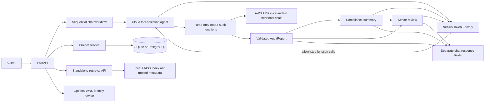

# Architecture

The application is a FastAPI service. Routes validate input and inject
settings; service modules own provider, AWS, persistence, and retrieval
boundaries. SQLAlchemy uses SQLite by default and supports PostgreSQL-compatible
URLs. Alembic migrations are available for managed deployments.

## Chat workflow

`POST /api/v1/chat` runs these stages sequentially:

1. **CloudAgent** sends the user's request and a fixed allowlist of read-only
   audit functions to the configured OpenAI-compatible model. It accepts only
   function calls from that allowlist with empty arguments.
2. The application executes the selected functions through `AWSAuditor`.
   S3 and IAM checks are global; EC2, VPC, RDS, and GuardDuty checks use
   `AWS_REGION`; CloudTrail checks discover enabled regions. AWS credentials
   come from the standard Boto3 credential chain.
3. Results are validated against the Pydantic `AuditReport` schema.
4. **ComplianceAgent** creates a short summary using the report and user
   request.
5. **SeniorAgent** reviews the same report and Compliance summary.
6. The API returns the structured report, Compliance summary, and Senior
   review in distinct fields. The response `sources` list is empty; local RAG
   has not been integrated into chat.

Checks include S3 public policy/ACL, TLS, versioning, and logging; IPv4/IPv6
public security-group ingress; CloudTrail logging and log-bucket protection;
GuardDuty detector status; EBS volume/default encryption and public snapshots;
and RDS instance/cluster backup, deletion-protection, and public snapshot checks.
They do not modify resources and are not a comprehensive assessment of every
AWS service or control.

## Other services

- **AWS identity:** `GET /api/v1/aws/identity` calls STS
  `GetCallerIdentity` using the standard credential chain.
- **Projects:** CRUD-like metadata endpoints persist through SQLAlchemy.
- **RAG:** Separate status/query endpoints use a local FAISS index and
  locally generated metadata. The default embedding implementation is
  deterministic feature hashing, not a semantic model. The index is built
  from authorized local Markdown and text documents.
- **Health:** `/health` reports process status. `/ready` reports basic
  database/index configuration and does not test live AWS or model access.

## Provider configuration

Inference defaults to Nebius Token Factory at
`https://api.tokenfactory.nebius.com/v1` using model
`nvidia/Nemotron-3_5-Lightning` and the OpenAI Chat Completions adapter. A
configured `NVIDIA_API_KEY` is required for the Cloud, Compliance, and Senior
LLM calls.
