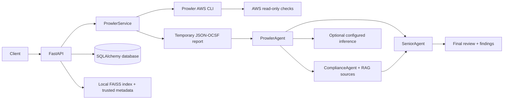

# Architecture

The application is a single FastAPI process. Routes validate requests and
inject settings; services own subprocess, provider, persistence, and retrieval
boundaries. SQLAlchemy supports SQLite for local development and compatible
PostgreSQL URLs. Alembic manages schema migrations.

`ProwlerService` invokes only the configured executable with a fixed AWS scan
command, JSON-OCSF output, configured region, `shell=False`, a restricted
environment, and a timeout. The report lives in a server-created temporary
directory, is size/count-checked, parsed, then removed with the directory.
Prowler findings are passed to `ProwlerAgent`, which returns a prioritized
summary without claiming remediation or certification. The agent batches all
findings to fit its configured input limit, then consolidates summaries when
multiple batches are required. `ComplianceAgent` assesses that summary against
retrieved knowledge-base passages. `SeniorAgent` reviews the Prowler summary,
compliance assessment, and supplied passages, identifying agreement,
disagreement, and uncertainty without inventing evidence. The API returns all
three assessments and the original parsed findings.

Both `POST /api/v1/prowler/scan` and `POST /api/v1/chat` initiate a fresh scan
of `AWS_REGION`. Chat also forwards the user's question and bounded history to
the agent. Scan routes require the Prowler executable, AWS credential-chain
configuration, and configured NVIDIA inference. The rest of the app does not
require those integrations to start.

Prowler's report content is untrusted input. The agent is instructed to ignore
embedded instructions and ground explanations only in report data. The
configured AWS identity should be limited to the read-only permissions needed
for assessment. No scan route changes AWS resources.

The default embedding is local deterministic feature hashing, which produces
384-dimensional normalized lexical vectors and requires no downloaded model.
It is not a semantic model. NVIDIA inference is gated on an explicit endpoint,
model identifier, key, and confirmed API-format setting.

There is no authentication or authorization implementation in this scaffold.
Project identifiers are references, not access controls. Protect access to
scan results because they may contain sensitive resource identifiers.
