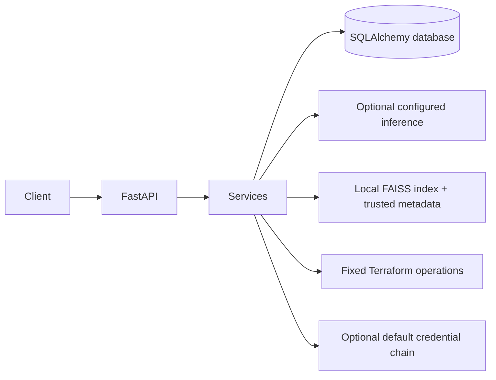

# Architecture

The application is a single FastAPI process. HTTP routes perform validation
and dependency injection, while services own provider and execution
boundaries. SQLAlchemy supports SQLite for local development and compatible
PostgreSQL URLs. Alembic is the schema migration mechanism.

The default embedding is local deterministic feature hashing, which produces
384-dimensional normalized lexical vectors and requires no downloaded model.
It is not a semantic model. NVIDIA inference is intentionally gated on an
explicit endpoint, model identifier, key, and a confirmed API-format setting.
The service does not guess provider endpoints or model IDs.

There is no authentication or authorization implementation in this
scaffold. Project identifiers are references, not access controls.
