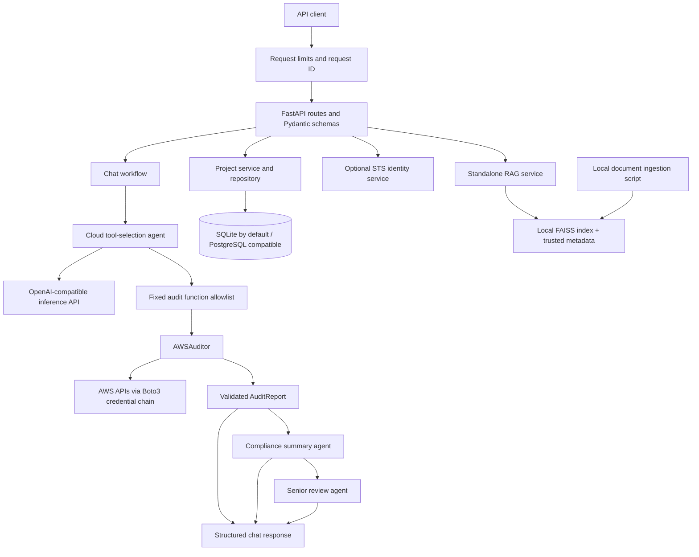

# Indra Backend: Project Overview

## What the project solves

Indra is a backend for AWS security assessment and AI-assisted review. It
provides a single API for selecting a bounded set of read-only AWS checks,
returning structured findings, and producing two sequential model reviews of
those findings. It also offers project metadata endpoints, an optional AWS
caller-identity check, and a separate local document-retrieval API.

The problem it addresses is the effort required to collect security-relevant
AWS configuration signals and turn them into a clear, reviewable summary.
Indra combines deterministic AWS API checks with model-generated explanation
while keeping the observations and the model's interpretation in separate
response fields.

Indra is a decision-support scaffold, not a cloud control plane or a complete
security product. It does not remediate AWS resources, inspect every AWS
service or control, certify compliance, or guarantee that an account is
secure.

## Main capabilities

- **AWS audit chat:** A model selects from a fixed list of read-only audit
  functions. The backend validates those selections, runs the matching AWS
  checks, validates the structured report, and returns it with separate
  Compliance and Senior reviews.
- **Project metadata:** SQLAlchemy-backed endpoints are intended to create,
  list, retrieve, and update projects.
- **AWS identity:** An optional endpoint calls STS `GetCallerIdentity` using
  the server's standard Boto3 credential chain.
- **Local retrieval:** A command-line ingestion script builds a FAISS index
  from authorized local Markdown and text documents. Separate endpoints report
  index status and retrieve attributed passages.
- **Health and readiness:** Local endpoints report process status and basic
  database/index configuration without calling AWS or the inference provider.

## Architecture



### Request and application layers

`app/main.py` creates the FastAPI application, registers the error handlers
and middleware, mounts health and versioned API routes, and applies database
migrations during application startup. Routes are deliberately thin: Pydantic
schemas validate input/output, dependency injection provides settings and
database sessions, and services encapsulate the work.

The application is divided into:

| Area | Responsibility |
| --- | --- |
| `app/api/` | HTTP routes and router registration |
| `app/schemas/` | Request, response, and AWS audit report validation |
| `app/core/` | Settings, stable API errors, logging, and bounded request middleware |
| `app/services/` | Chat agents/workflow, AWS identity, embeddings, retrieval, and project use cases |
| `app/repositories/` | Database queries and project persistence |
| `app/db/` | SQLAlchemy models, engine/session setup, and migration integration |
| `app/tools/audit/aws/` | Service-specific read-only Boto3 audit functions |
| `migrations/` | Alembic environment and versioned schema changes |
| `scripts/` | Local retrieval ingestion and environment checks |
| `tests/` | API, service, workflow, configuration, and audit tests |
| `docs/` | API, architecture, security, and project documentation |

## AWS audit and chat workflow

`POST /api/v1/chat` runs the following steps:

1. The API validates a message (up to 8,000 characters) and optional
   conversation history (up to 20 messages, each up to 4,000 characters).
2. The Cloud agent sends the request, history, and a fixed set of tool
   definitions to the configured OpenAI-compatible inference provider.
3. The provider may select only allowlisted audit tools. Tool arguments must
   be empty; arbitrary AWS operations, resource arguments, and regions are
   rejected.
4. `AWSAuditor` executes selected checks using Boto3. S3 and IAM checks are
   global; EC2/EBS, VPC, RDS, and GuardDuty checks use `AWS_REGION`.
   CloudTrail checks discover enabled regions.
5. Results are validated against the `AuditReport` schema. Findings include
   service, region, check identifiers, severity, details, and any available
   evidence or error.
6. The Compliance agent summarizes the structured report. The Senior agent
   then reviews that report and the Compliance summary for unsupported claims
   and uncertainty.
7. The API returns the report, Compliance summary, Senior review, an operation
   identifier, a completed status, and a `sources` array.

The current audit functions cover:

| Service | Selected checks |
| --- | --- |
| S3 | Public-access block, public bucket policy/ACL, default encryption, versioning, TLS-only policy, and server access logging |
| IAM | Root-account access keys |
| EC2 / EBS | World-open IPv4/IPv6 security-group ingress, public IPs on running instances, unencrypted volumes, EBS default encryption, and public snapshots |
| VPC | Default VPCs and VPC Flow Logs |
| RDS | Public accessibility, storage encryption, Multi-AZ, backup retention, deletion protection, and public manual snapshots |
| CloudTrail | Multi-region coverage, active logging, log-file validation, and log-bucket public-access-block/encryption |
| GuardDuty | Detector presence and enabled state in the configured region |

The model chooses which checks to run; a request does not necessarily run every
check. The AWS process identity must have the read permissions required by
selected checks. Some permission and service errors are returned as findings.
The results are point-in-time observations and should be reviewed before
making operational decisions.

### Inference provider

The default provider is Nebius Token Factory through the OpenAI Chat
Completions-compatible adapter. Configuration includes a base URL, API key,
model, and adapter format. A valid `NVIDIA_API_KEY` is required for chat
inference. Provider credentials are server-side and are not accepted in API
request bodies.

## Other API workflows

The versioned API is mounted at `/api/v1`; `/health` and `/ready` are mounted
at the root.

| Method | Path | Purpose |
| --- | --- | --- |
| `GET` | `/health` | Process health; no AWS or model call |
| `GET` | `/ready` | Basic database and local index configuration status |
| `POST` | `/api/v1/chat` | AWS audit and sequential model review |
| `GET`, `POST` | `/api/v1/projects` | Paginated project list and project creation |
| `GET`, `PATCH` | `/api/v1/projects/{project_id}` | Read or update project metadata |
| `GET` | `/api/v1/aws/identity` | Optional STS caller identity lookup |
| `GET` | `/api/v1/rag/status` | Local retrieval-index status |
| `POST` | `/api/v1/rag/query` | Search local passages and return attribution |

Expected application errors use a stable JSON envelope:

```json
{
  "error": {
    "code": "error_code",
    "message": "Safe explanation.",
    "details": {}
  }
}
```

Request validation errors report field locations and error types rather than
echoing submitted values. The request middleware enforces a configurable body
size limit and attaches an `X-Request-ID` response header.

## Local document retrieval

Retrieval is a standalone feature; **chat does not currently retrieve local
documents**. Chat returns an empty `sources` array. The retrieval path works
as follows:

1. Place authorized UTF-8 `.md` and `.txt` documents under
   `knowledge_base/` (or supply another source directory).
2. Run `python scripts/ingest_documents.py`.
3. The script splits files into passages, generates source metadata, and
   writes a FAISS index and matching metadata file.
4. `POST /api/v1/rag/query` embeds the query with the configured local
   feature-hash implementation, searches the index, and returns passages with
   attribution fields.

The current embedding is deterministic feature hashing with 384 dimensions.
It is a local baseline, not a semantic embedding model. Retrieval metadata is
stored as a pickle file; only locally generated, trusted metadata must be
loaded. The index and metadata files must be kept as a matching pair.

## Persistence and database migrations

SQLAlchemy models currently include:

- **User:** ID, unique external/user identifier, optional safe summary, and
  timestamps.
- **Project:** name, description, status, required owner ID, and timestamps.
- **Operation:** project reference, operation type/status, timestamps, and
  optional safe summary.

SQLite is the default database. PostgreSQL-compatible URLs are supported when
the optional PostgreSQL driver is installed. Alembic migrations are located in
`migrations/` and can be applied with `alembic upgrade head`; application
startup also upgrades the configured database to the current migration head.
The current schema revision adds the users table and makes project ownership
required.

**Current project-owner implementation gap:** The database schema now requires
every project to reference a user, but the project creation request and
repository do not yet accept or assign an owner, and the service has no
authentication/user context. Consequently, project creation currently fails
against the migrated schema. The project endpoints should not be treated as
usable until an ownership workflow is implemented. The chat request accepts a
`project_id`, but the current route/workflow does not use or persist it.
Likewise, the operation identifier returned by chat is generated for the
response; the chat workflow does not currently persist an `Operation` row.

## Configuration

Settings are loaded from environment variables or an optional `.env` file.
`.env.example` is the placeholder template. See `app/core/config.py` for the
source of defaults.

| Variable | Default | Use |
| --- | --- | --- |
| `APP_NAME` | `Indra API` | Service name |
| `APP_ENV` | `development` | Development enables `/docs` and `/redoc` |
| `DEBUG` | `false` | FastAPI debug mode |
| `API_V1_PREFIX` | `/api/v1` | Versioned route prefix |
| `DATABASE_URL` | `sqlite:///./data/indra.db` | Database connection |
| `NVIDIA_BASE_URL` | `https://api.tokenfactory.nebius.com/v1` | Inference endpoint |
| `NVIDIA_API_KEY` | empty | Server-side inference credential |
| `NVIDIA_MODEL` | `nvidia/Nemotron-3_5-Lightning` | Inference model |
| `NVIDIA_API_FORMAT` | `openai-chat-completions` | Provider adapter format |
| `AWS_REGION` | `us-east-1` | Regional audits and STS identity |
| `EMBEDDING_MODEL` | `local-feature-hash-v1` | Local retrieval embedding |
| `FAISS_INDEX_PATH` | `./faiss_store/index.faiss` | FAISS index file |
| `FAISS_METADATA_PATH` | `./faiss_store/metadata.pkl` | Trusted local metadata |
| `KNOWLEDGE_BASE_PATH` | `./knowledge_base` | Default ingestion directory |
| `CORS_ORIGINS` | empty | Comma-separated allowed origins |
| `MAX_REQUEST_BYTES` | `1048576` | Request-body limit, bounded by settings validation |

AWS credentials use the standard Boto3 credential chain and are checked only
when AWS functionality is called. The application can start without AWS or
inference credentials; chat and identity functionality require their
respective integrations.

## Run and develop

From the `indra-ai/` project directory:

```bash
python3.12 -m venv .venv
source .venv/bin/activate
python -m pip install --upgrade pip
python -m pip install -e '.[dev]'
cp .env.example .env
```

Set `NVIDIA_API_KEY` in `.env` to enable model calls. Configure AWS access
through a suitably scoped role/profile or another standard Boto3 credential
source. Do not use privileged credentials for routine operation.

Start the API:

```bash
uvicorn app.main:app --reload
```

Development API docs are available at `http://127.0.0.1:8000/docs` when
`APP_ENV=development`.

Useful validation commands:

```bash
pytest
ruff check .
ruff format --check .
python -m compileall -q app tests
```

Rebuild local retrieval data after adding documents:

```bash
python scripts/ingest_documents.py
```

Tests use mocks for external AWS/provider dependencies and should not require
live credentials. Live calls can incur AWS or provider usage.

## Security boundaries and limitations

- There is no API authentication, authorization, tenant isolation, or complete
  audit trail. Project identifiers are references, not access controls.
- The project-owner database schema has advanced beyond the project API's
  ownership support; see the persistence section above.
- AWS chat uses a fixed allowlist of read-only audit calls. It does not modify
  AWS resources and does not cover every service or control.
- AWS identity calls STS only; it does not inspect account resources or IAM
  policies.
- Model-generated Compliance and Senior reviews are decision support, not
  formal compliance mappings, legal advice, certification, or guarantees.
- Chat does not use RAG, so it cannot cite local knowledge-base passages.
- Local pickle metadata is trusted input. Never replace it with a user-provided
  file.
- Do not store credentials in projects, operations, prompts, documents, logs,
  or source control. Keep `.env` private and use least-privilege cloud access.

## Further reading

- [API overview](./api.md)
- [Architecture notes](./architecture.md)
- [Security notes](./security.md)
- [Contribution guide](../CONTRIBUTING.md)
